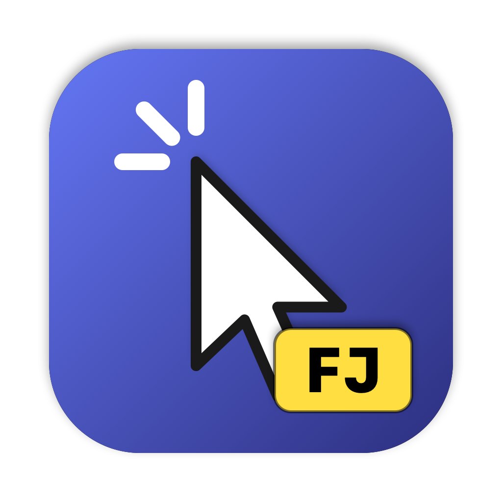
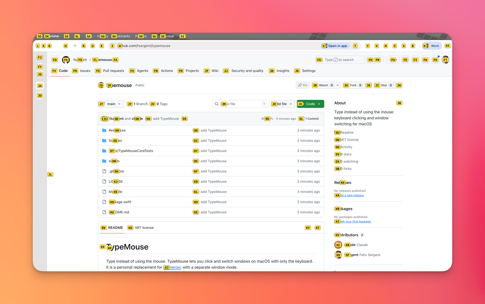
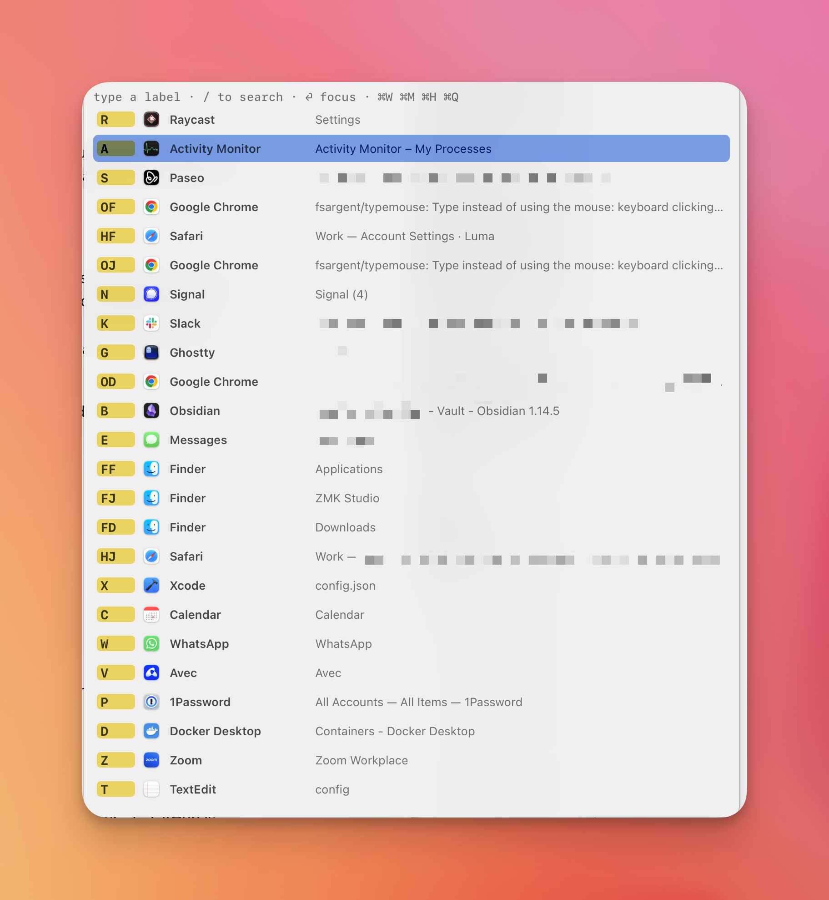

# TypeMouse

Type instead of using the mouse. TypeMouse lets you click and switch windows on macOS with only the keyboard.
It is a personal replacement for [Homerow](https://www.homerow.app), with a separate window mode.

**Click mode** puts a label on every clickable element. Type the label to click it.



**Window mode** lists your windows. Each app keeps the same letter, so you can switch by muscle memory.



## Modes

| Hotkey | Mode | What it does |
|---|---|---|
| `hyper+space` | Click | Shows a label on each clickable element. Type the label to click it. |
| `hyper+backspace` | Search | Type part of an element's text. Press `Enter` to click the highlighted match. |
| `hyper+tab` | Window | Shows a list of windows with stable labels. Type a label to focus the window. |

### Click mode keys

| Key | Action |
|---|---|
| label | Click |
| `⇧` + last label key | Right-click |
| `⌘` + last label key | ⌘-click (for example, open a link in a new tab) |
| `⌃` + last label key | Double-click |
| `⌥` + last label key | Move the mouse only (hover) |
| `/` or `Tab` | Switch to search |
| `Backspace` | Delete the last typed key |
| `Esc` or the hotkey again | Exit |

If a menu is open, click mode labels only the menu items.
Open a menu-bar menu with one label, then press the hotkey again to pick an item.

### Search mode keys

| Key | Action |
|---|---|
| text | Filter by title, description, value, or placeholder |
| `Tab` / `↓` / `⌃N` | Next match |
| `⇧Tab` / `↑` / `⌃P` | Previous match |
| `Enter` (with `⇧`, `⌘`, `⌃`, `⌥`) | Click the highlighted match (same modifiers as click mode) |
| `Backspace` on an empty query | Go back to labels |

### Window mode keys

Each app gets one stable letter. An app with one window uses one key. An app with several windows uses two keys.
The second key comes from the hint characters, in most-recently-used order.

| Key | Action |
|---|---|
| label | Focus that window (or launch a pinned app) |
| `Enter` | Focus the highlighted row. The previous window is highlighted first, so `hyper+tab`, `Enter` toggles between two windows. |
| hotkey again, `Tab`, `↓`, `⌃N` | Next row |
| `↑`, `⇧Tab`, `⌃P` | Previous row |
| `/` or any key that is not a label | Fuzzy filter by app name and window title |
| `⌘W` / `⌘M` / `⌘H` / `⌘Q` | Close / minimize / hide app / quit app for the highlighted row |
| `Esc` | Exit |

Pin letters to apps so that they never change. A pinned app that is not running shows a "launch" row.

## Configuration

TypeMouse reads `~/.config/typemouse/config.json` and reloads it when the file changes.
TypeMouse writes the defaults on first launch. Every key is optional.

```json
{
  "hintCharacters": "fjdkslaghrueiwotyvmcxbn",
  "hotkeys": { "click": "hyper+space", "search": "hyper+backspace", "window": "hyper+tab" },
  "windowPins": { "c": "com.google.Chrome", "s": "com.tinyspeck.slackmacgap", "t": "com.mitchellh.ghostty" },
  "clickStrategy": { "com.example.app": "mouse" },
  "restoreMousePosition": true,
  "labelFontSize": 12,
  "enhancedUserInterfaceApps": ["com.google.Chrome", "com.brave.Browser", "…"]
}
```

- Hotkey modifiers: `hyper` (⌘⌃⌥⇧), `meh` (⌃⌥⇧), `cmd`, `ctrl`, `opt`, `shift`.
- `clickStrategy`: `auto` (default) uses AXPress, with a mouse click for web content and when AXPress fails. `press` never moves the mouse. `mouse` always sends a mouse click.
- `enhancedUserInterfaceApps`: apps that get the `AXEnhancedUserInterface` flag. Chromium browsers need it to show web page labels. The default lists Chrome, Brave, Edge, Arc, Vivaldi, and Opera. The flag can slow window moves by tools such as Rectangle or Raycast.
- To find a bundle identifier, run `osascript -e 'id of app "Slack"'`.

## Download

Each release on the [Releases page](https://github.com/fsargent/typemouse/releases) has a universal `TypeMouse-<version>.zip`.

1. Download and unzip it.
2. Move `TypeMouse.app` to `/Applications` or `~/Applications`.
3. Remove the download quarantine: `xattr -dr com.apple.quarantine /Applications/TypeMouse.app`
4. Open the app, then grant Accessibility permission when macOS asks.

Release builds have an ad-hoc signature, not an Apple Developer ID.
macOS sees each new version as a new app.
After an update, remove TypeMouse from the Accessibility list and grant permission again.

## Publish a release

1. Push a version tag: `git tag v0.2.0 && git push origin v0.2.0`
2. The `Release` workflow runs the tests and builds a universal app.
3. The workflow publishes the zip and its SHA-256 checksum with generated release notes.

## Build and install from source

You do not need a paid Apple Developer account.

1. Create the signing identity (one time): `make cert`
2. Build, sign, and install in `~/Applications`: `make app`
3. Start it: `open ~/Applications/TypeMouse.app`
4. Grant Accessibility permission when macOS asks.
5. After a rebuild, run `make restart`. The permission stays because the signing identity stays the same.

TypeMouse turns on "Launch at login" on first launch. Use the menu-bar toggle to turn it off.

Run the unit tests with `make test`.

If Homerow is running, quit it or change its shortcuts. The two apps use the same default hotkeys.

## Diagnostics

The diagnostics run inside the app bundle, so they use the app's Accessibility permission.

- `make dump APPNAME=Slack`: list the click targets in Slack's focused window, with scan times.
- `make windows`: list windows with their window-mode labels.
- The log is at `~/Library/Logs/TypeMouse/typemouse.log`. It records each scan time and each click.

## How it works

- **Hotkeys**: Carbon `RegisterEventHotKey`.
- **Key capture**: a `CGEventTap` on its own thread. It is on only while a mode is active. The target app keeps focus, so its menus and popovers stay open.
- **Element discovery**: an Accessibility tree walk of the focused window and menu bar. It uses batched attribute reads, off-screen pruning, parallel subtrees, and a 250 ms cap on each AX call. Web areas use one `AXUIElementsForSearchPredicate` query instead of a DOM walk.
- **Clicking**: `AXPress` when it works, a synthetic mouse event when it does not.
- **Windows**: AX window lists (no Screen Recording permission needed), MRU tracking through workspace and AX notifications, and focus through private SkyLight calls (the technique used by yabai and AltTab).

## Limits

- Window mode shows windows on the current Space only, plus minimized windows and windows of hidden apps.
- Secure Input (password fields) blocks key capture.
- Scroll mode is not part of TypeMouse.

## License

MIT. See [LICENSE](LICENSE).
