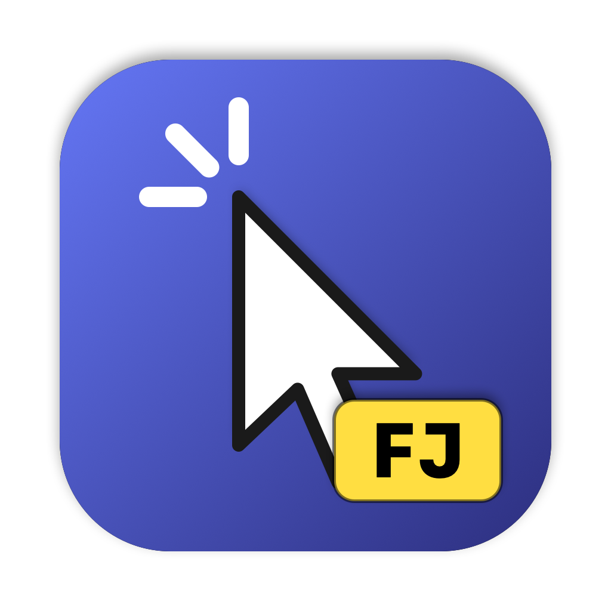
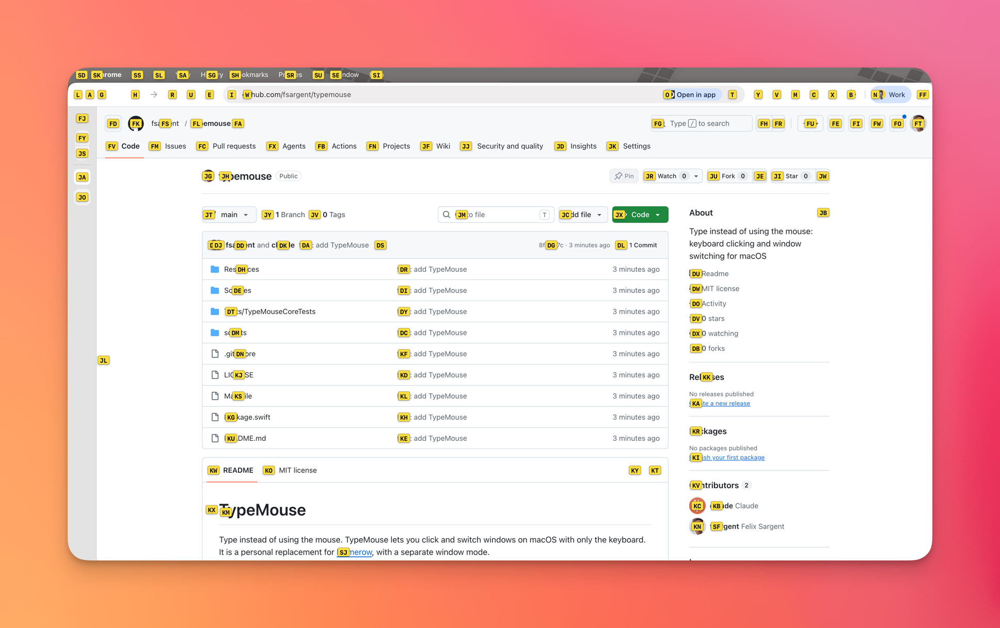
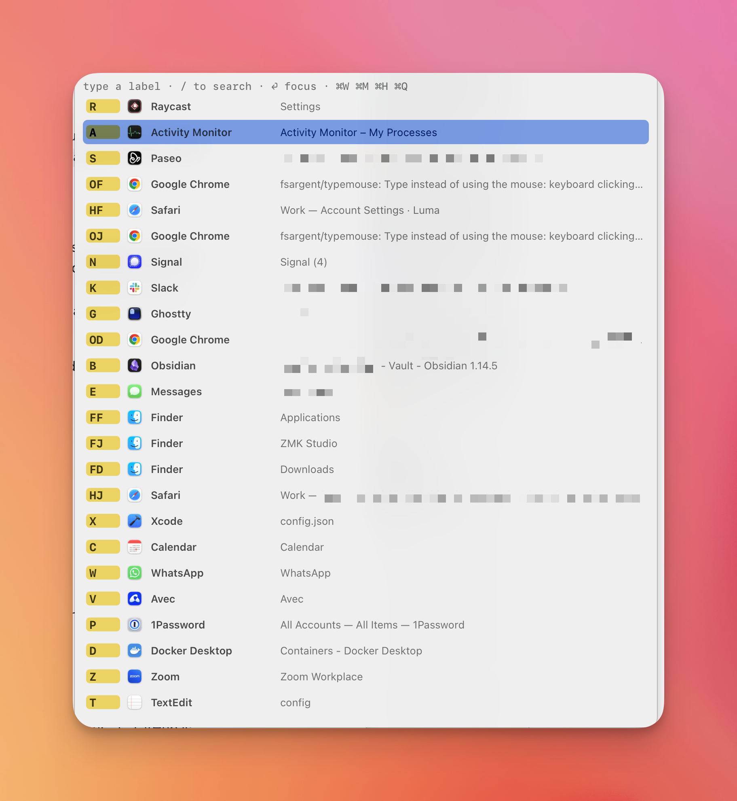

# TypeMouse

Type instead of using the mouse. TypeMouse lets you click and switch windows on macOS with only the keyboard.
It is a personal replacement for [Homerow](https://www.homerow.app), with a separate window mode.

**Click mode** puts a label on every clickable element. Type the label to click it.



**Window mode** lists your windows. Each app keeps the same letter, so you can switch by muscle memory.



## Modes

| Hotkey | Mode | What it does |
|---|---|---|
| `hyper+j` | Click | Shows a label on each clickable element. Type the label to click it. |
| `hyper+k` | Window picker | Shows one label on each visible window. Press the label to focus that window. |
| `hyper+l` | Window | Shows a list of windows with stable labels. Type a label to focus the window. |
| none | Search | Type part of an element's text. Press `Enter` to click the highlighted match. |

All default hotkeys use Hyper: Command (⌘) + Control (⌃) + Option (⌥) + Shift (⇧) together.
If your keyboard has no Hyper key, turn on **Use Caps Lock as Hyper** in Settings. See [Caps Lock as Hyper](#caps-lock-as-hyper).

Search has no hotkey by default. Press `/` or `Tab` in click mode to search, or add a hotkey in Settings.

### Click mode keys

| Key | Action |
|---|---|
| label | Click |
| Shift (⇧) + label | Chain click: click, wait 250 ms (`chainDelayMs`), then show new labels and stay in click mode |
| Control (⌃) + label | Right-click |
| Command (⌘) + label | Command-click (for example, open a link in a new tab) |
| Option (⌥) + label | Double-click |
| Control (⌃) + Option (⌥) + label | Move the mouse only (hover) |
| `Space` | Turn chain mode on or off. In chain mode, every click is a chain click. To start in chain mode, set `chainModeByDefault`. |
| Up arrow / Down arrow in chain mode | Make the chain click delay 50 ms longer or shorter |
| `/` or `Tab` | Switch to search |
| `Backspace` | Delete the last typed key |
| `Esc` or the hotkey again | Exit |

To use a modifier, hold it down while you type the label.
For a two-key label, you only need to hold it for the second key.

Labels go by element type. Buttons get the shortest labels, then text fields, then links, then other elements.
A browser's own tabs, toolbar, and bookmarks come after the page, and the menu bar comes last.
Within each type, labels follow reading order.
To use reading order only, set `"prioritizeLabels": false` or turn it off in Settings.

Labels of the same length are spread out, so neighbors start with different keys (as in Vimium).
An icon inside a button, or a card around its link, gets no label of its own (as in Vimium C).

Shift combines with the other modifiers. For example, Shift (⇧) + Command (⌘) + label opens a link in a new tab and stays in click mode for the next link.

If a menu is open, click mode labels only the menu items.
Open a menu-bar menu with one label, then press the hotkey again to pick an item.

### Search mode keys

| Key | Action |
|---|---|
| text | Filter by title, description, value, or placeholder |
| `Tab`, Down arrow, or Control (⌃) + `N` | Next match |
| Shift (⇧) + `Tab`, Up arrow, or Control (⌃) + `P` | Previous match |
| `Enter` | Click the highlighted match. Hold the same modifiers as in click mode for the other click types. |
| `Backspace` on an empty query | Go back to labels |

### Window picker keys

The window picker labels each window that is at least partly visible on the current Space.
The label sits in the middle of the largest part of the window that shows. Its size is about half of that part, so big windows get big labels.
Labels come from app names, so they stay the same when windows move:

- An app with one visible window gets its first letter. Slack is `S`.
- Apps that share a first letter get two letters from their names. Slack and Safari are `SL` and `SA`.
- Several windows of one app get the app letter plus a hint character, oldest window first.
- `windowPins` in the config gives an app a letter and reserves it. Other apps skip that letter and use the next letter of their name.

| Key | Action |
|---|---|
| label | Focus that window, then start click mode in it |
| `Backspace` | Delete the last typed key |
| `Esc` or the hotkey again | Exit |

### Window mode keys

Window mode uses the same labels as the window picker. The list shows on every monitor.

| Key | Action |
|---|---|
| label | Focus that window (or launch a pinned app) |
| `Enter` | Focus the highlighted row. The previous window is highlighted first, so `hyper+l`, `Enter` toggles between two windows. |
| Hotkey again, `Tab`, Down arrow, or Control (⌃) + `N` | Next row |
| Up arrow, Shift (⇧) + `Tab`, or Control (⌃) + `P` | Previous row |
| `/` or any key that is not a label | Fuzzy filter by app name and window title |
| Command (⌘) + `W` | Close the highlighted window |
| Command (⌘) + `M` | Minimize the highlighted window |
| Command (⌘) + `H` | Hide the highlighted window's app |
| Command (⌘) + `Q` | Quit the highlighted window's app |
| `Esc` | Exit |

Pin letters to apps so that they never change. A pinned app that is not running shows a "launch" row.

## Settings

Open **Settings…** from the menu-bar icon, or open TypeMouse again while it runs.

- **Hotkeys**: click a hotkey, then press the new key combination. Press `Esc` to cancel. Click **+ Add** to give a mode a second hotkey. Click **×** to clear a hotkey and turn that mode off.
- **Labels**: hint characters and label size.
- **Behavior**: chain click delay (milliseconds), click mode after the window picker, mouse position after a click, and launch at login.

The settings window writes the same config file described below.

## Caps Lock as Hyper

Turn on **Use Caps Lock as Hyper** in Settings, or set `"capsLockToHyper": true`.
Then hold Caps Lock and press a key to send Hyper + that key, for example Caps Lock + J for click mode.

- TypeMouse remaps Caps Lock to F18 with the macOS key remap service (the one `hidutil` uses). Other remaps stay.
- While you hold Caps Lock, TypeMouse adds the four Hyper modifiers to each key you press.
- Caps Lock no longer turns on capital letters, and its light stays off.
- TypeMouse removes the remap when you turn the setting off or quit the app.
- Leave this off if Karabiner, kanata, or a custom keyboard already gives you a Hyper key.

If TypeMouse stops without removing the remap, start TypeMouse again or restart the Mac.
To remove all remaps by hand, run `hidutil property --set '{"UserKeyMapping":[]}'`.

### Recommended: kanata and Kanata Bar

To customize your keyboard further, use [kanata](https://github.com/jtroo/kanata).
It remaps keys and adds layers, home-row modifiers, and tap-hold keys, such as Caps Lock as Escape when tapped and Hyper when held.
[Kanata Bar](https://github.com/not-in-stock/kanata-bar) is a menu-bar app that starts kanata and keeps it running on macOS.
If you use kanata, leave **Use Caps Lock as Hyper** off and make the Hyper key in kanata.


## Configuration

TypeMouse reads `~/.config/typemouse/config.json` and reloads it when the file changes.
TypeMouse writes the defaults on first launch. Every key is optional.

```json
{
  "hintCharacters": "fjdkslaghrueiwotyvmcxbn",
  "hotkeys": { "click": "hyper+j", "picker": "hyper+k", "window": "hyper+l", "search": [] },
  "windowPins": { "c": "com.google.Chrome", "s": "com.tinyspeck.slackmacgap", "t": "com.mitchellh.ghostty" },
  "clickStrategy": { "com.example.app": "mouse" },
  "restoreMousePosition": true,
  "clickAfterPicker": true,
  "chainDelayMs": 250,
  "chainModeByDefault": false,
  "capsLockToHyper": false,
  "prioritizeLabels": true,
  "labelFontSize": 12,
  "enhancedUserInterfaceApps": ["com.google.Chrome", "com.brave.Browser", "…"]
}
```

- Hotkey modifiers: `cmd` (Command, ⌘), `ctrl` (Control, ⌃), `opt` (Option, ⌥), `shift` (Shift, ⇧).
  `hyper` means all four. `meh` means Control, Option, and Shift.
- A mode takes one hotkey or a list, for example `"search": ["hyper+o", "hyper+backspace"]`.
- `[]` or `""` means no hotkey. A missing key uses the default.
- `clickStrategy`: `auto` (default) uses AXPress, with a mouse click for web content and when AXPress fails. `press` never moves the mouse. `mouse` always sends a mouse click.
- `enhancedUserInterfaceApps`: apps that get the `AXEnhancedUserInterface` flag. Chromium browsers need it to show web page labels. The default lists Chrome, Brave, Edge, Arc, Vivaldi, and Opera. The flag can slow window moves by tools such as Rectangle or Raycast.
- To find a bundle identifier, run `osascript -e 'id of app "Slack"'`.

## Install with Homebrew

```sh
brew install --cask fsargent/tap/typemouse
```

The cask removes the download quarantine. After you install it, grant Accessibility permission when macOS asks.
`brew upgrade` installs new releases. After each upgrade, grant Accessibility permission again (see the note under Download).

## Download

Each release on the [Releases page](https://github.com/fsargent/typemouse/releases) has a universal `TypeMouse-<version>.zip`.

1. Download and unzip it.
2. Move `TypeMouse.app` to `/Applications` or `~/Applications`.
3. Remove the download quarantine: `xattr -dr com.apple.quarantine /Applications/TypeMouse.app`
4. Open the app, then grant Accessibility permission when macOS asks.

Release builds have an ad-hoc signature, not an Apple Developer ID.
macOS sees each new version as a new app.
After an update, remove TypeMouse from the Accessibility list and grant permission again.

## Publish a release

1. Push a version tag: `git tag v0.2.0 && git push origin v0.2.0`
2. The `Release` workflow runs the tests and builds a universal app.
3. The workflow publishes the zip and its SHA-256 checksum with generated release notes.

## Build and install from source

You do not need a paid Apple Developer account.

1. Create the signing identity (one time): `make cert`
2. Build, sign, and install in `~/Applications`: `make app`
3. Start it: `open ~/Applications/TypeMouse.app`
4. Grant Accessibility permission when macOS asks.
5. After a rebuild, run `make restart`. The permission stays because the signing identity stays the same.

TypeMouse turns on "Launch at login" on first launch. Use the menu-bar toggle to turn it off.

Run the unit tests with `make test`.

If Homerow is running, quit it or change its shortcuts. The two apps use the same default hotkeys.

## Diagnostics

The diagnostics run inside the app bundle, so they use the app's Accessibility permission.

- `make dump APPNAME=Slack`: list the click targets in Slack's focused window, with scan times.
- `make windows`: list windows with their window-mode labels.
- `TypeMouse --visible`: list the windows the window picker labels. Run it with `open` and `--out FILE`, like `make dump`.
- `TypeMouse --post-key hyper+j`: send a synthetic key press, to test a hotkey end to end.
- `TypeMouse --keylog 30`: print each key press and its modifiers for 30 seconds.

If a hotkey does nothing, another app can own it. macOS does not report a conflict when two apps register the same hotkey.
- The log is at `~/Library/Logs/TypeMouse/typemouse.log`. It records each scan time and each click.

## How it works

- **Hotkeys**: Carbon `RegisterEventHotKey`.
- **Key capture**: a `CGEventTap` on its own thread. It is on only while a mode is active. The target app keeps focus, so its menus and popovers stay open.
- **Element discovery**: an Accessibility tree walk of the focused window and menu bar. It uses batched attribute reads, off-screen pruning, parallel subtrees, and a 250 ms cap on each AX call. Web areas use one `AXUIElementsForSearchPredicate` query instead of a DOM walk.
- **Clicking**: `AXPress` when it works, a synthetic mouse event when it does not.
- **Windows**: AX window lists (no Screen Recording permission needed), MRU tracking through workspace and AX notifications, and focus through private SkyLight calls (the technique used by yabai and AltTab).

## Limits

- Window mode shows windows on the current Space only, plus minimized windows and windows of hidden apps.
- Secure Input (password fields) blocks key capture.
- Scroll mode is not part of TypeMouse.

## License

MIT. See [LICENSE](LICENSE).
